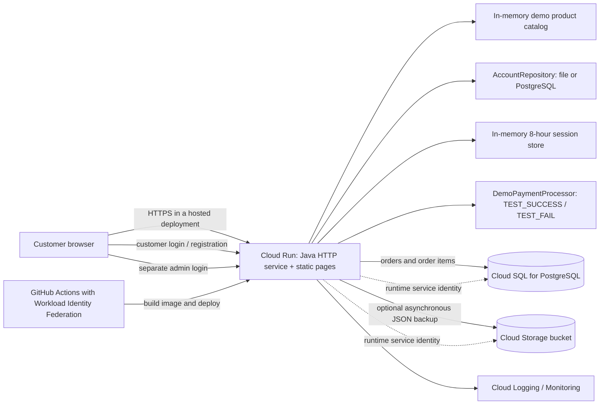
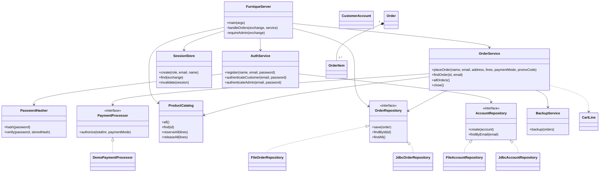
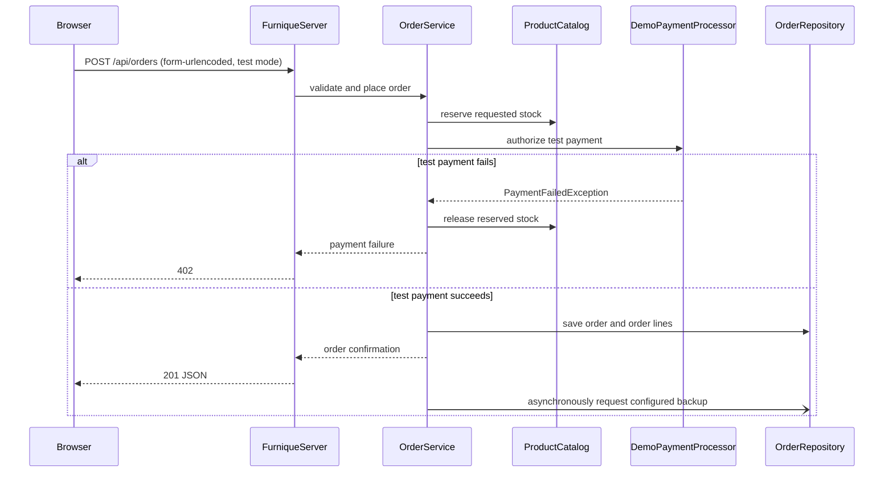

# Furnique Studio — solution architecture

## Context

This is a student-project prototype, not a production storefront. It combines a responsive static storefront, a Java 8-compatible HTTP service, server-backed customer accounts, separate environment-configured administrator authentication, test payment handling, and file/PostgreSQL repositories.

## Component view

In local development the Java service serves the frontend assets from its packaged resources. Without `DB_URL`, it uses file-backed order persistence under `DATA_DIRECTORY`. A supplied `DB_URL` selects PostgreSQL. `GCS_BUCKET` enables optional backups using Application Default Credentials.

## Java class view

## Request and order sequence

## Trust boundaries and controls

- Public catalog and checkout endpoints accept user input; order fields, quantities, product IDs, and promotions are validated server-side.
- Customer passwords use salted PBKDF2-HMAC-SHA256 with 600,000 iterations. Customer and admin credentials use separate routes; admin credentials come from server environment/Secret Manager, never the customer-registration form.
- Successful login creates an unpredictable, 8-hour in-memory session cookie with HttpOnly and SameSite=Strict; Secure is enabled by `COOKIE_SECURE=true` for HTTPS. Auth attempts have a small per-process IP throttle.
- `/api/admin/orders` accepts either an administrator session or the existing API token for non-browser smoke/admin integration. Customer sessions are explicitly denied.
- SQL writes use prepared statements. Order lookup requires both order ID and matching email.
- The legacy browser admin preview remains local/demo-only. The new `/admin.html` workspace uses the protected server order endpoint.
- The `TEST_SUCCESS` payment mode is deliberately not a real payment integration.

## Known architectural limitations

1. Product and stock catalog are in process memory, not persisted in PostgreSQL. Cloud Run restarts reset stock, and multiple instances have independent stock; do not treat demo stock as authoritative.
2. Sessions and the login throttle are in process memory; restarts invalidate sessions and multiple instances cannot share sessions/throttle state. Use a shared session service and distributed rate limiting before scaling.
3. There is no email verification, password reset/recovery, MFA, customer-order history, production payment gateway, email delivery, fulfilment integration, or production-ready privacy/consent lifecycle.
4. The HTTP server is a simple Java built-in server, not a hardened production framework. Complete security, load, recovery, and privacy review before real customer use.

## Intended cloud shape

For a classroom demonstration only: Cloud Run, same-region Cloud SQL PostgreSQL, optional Cloud Storage backup bucket, a dedicated runtime service account, Secret Manager for admin password, API token, and database password, and GitHub Actions authenticated with Workload Identity Federation. The included workflow is not live until repository variables, IAM bindings, billing approval, database, bucket, and Artifact Registry are configured.
